# 《塞尔达传说：时之笛》(Ship of Harkinian) Switch 9.3.0 深度定制简体中文版

<div align="center">


**基于官方最新 9.3.0-nx1 底层 · 融合 PC 9.2.3 完整汉化资产 · 非侵入式全配置菜单汉化 · 官方共享字库直通**

[](https://github.com/Zeton-beller/soh-switch-chinese)
[](https://github.com/timschneeb/Shipwright-Switch)
[-brightgreen)](https://github.com/Zeton-beller/soh-switch-chinese)
[](https://github.com/Zeton-beller/soh-switch-chinese)

</div>

---

## 📖 项目简介与定位

**本项目是经典反编译神作《塞尔达传说：时之笛》（Ship of Harkinian, 简称 SoH）面向 Nintendo Switch 平台的官方 9.3.0 深度定制简体中文全功能移植版本。**

在过去社区旧版本的 Switch 移植中，普遍存在**游戏手柄按键映射颠倒**、**锁定视角时宽银幕电影黑边无法全屏**、**无内置中文字体导致汉字全部显示为方块豆腐块 (`□`) 或问号 (`?`)**、以及**几千项高级增强配置菜单全部为英文**等痛点。

本项目针对上述难题进行了系统级重构，实现了从**底层源码移植**、**操作系统字库直通**、**UI 总线透明多语言钩子**，到**官方标准加密 NSP 桌面安装包**的一体化完整闭环。

---

## 🌟 核心特性与技术亮点

1. **官方 9.3.0-nx1 全新架构升级**：
   - 彻底修复旧版 Switch 手柄按键错乱的顽疾，完美匹配 Switch 物理按键与任天堂手柄逻辑；
   - 原生支持陀螺仪瞄准微调、全分辨率 1080p 满血输出与全局 60FPS / 自由插帧渲染。
2. **非侵入式配置菜单 100% 全汉化（Non-invasive Bus Hook）**：
   - 不修改上游官方几十个菜单 `.cpp` 源码，开发了全局总线字符转译钩子 `SohMenuLocalization`；
   - 涵盖图形画质、增强功能、音频、手柄映射、随机发生器（Randomizer）以及 **218 项速通身法技巧（Tricks）**，全库 **1,099+ 项配置词条**全部实现 100% 纯净人工级重写润色，绝无任何机翻或中英夹杂。
3. **独立双版本并行交付架构**：
   - **版本 A (`soh_9.3.0_cn_orig_menu.nro`)**：仅包含游戏剧情与文本汉化，设置菜单保持原汁原味原生英文；
   - **版本 B (`soh_9.3.0_cn_full_menu.nro`)**：全汉化旗舰版，剧情文本与设置菜单 100% 全汉化。
4. **Switch 官方简体中文字库零空间挂载（Zero-Footprint Shared Font）**：
   - 抛弃在 SD 卡额外携带数十兆外部 TTF 字体的传统做法，直接调用 Switch 操作系统底层 `pl:u` 服务；
   - 动态提取官方固件内置的标准方正/Nintendo Sans 简体中文字体，字形渲染风格与 Switch 官方系统界面保持 100% 物理一致。
5. **配套官方标准加密桌面独立安装包 (NSP Forwarder)**：
   - 采用官方密钥经过 AES-128 加密与哈希签名封包，分配独占 Title ID (`05534F4800000001`)；
   - 包含专属 1024x1024 高清林克拔剑中文艺术角标封面，桌面一键点击即可享有 **3.2GB 满血内存 Title 权限**运行，免除相册 Applet 模式内存不足崩溃的困扰。

---

## 🛠️ 项目技术架构与实现全流程（精确到每一步骤）

本项目研发过程分为 **4 大核心技术阶段**：

```mermaid
flowchart TD
    subgraph S1["阶段一：跨版本资产与源码精准融合"]
        A["官方 Switch 9.3.0-nx1 源码树"] --> C["融合核心代码树"]
        B["PC 9.2.3 简体中文资产库 (assets/xml)"] --> C
        C --> D["实时资源编译工具 GenerateSohOtr"]
        D --> E["生成同步专用资产包 soh.o2r"]
    end

    subgraph S2["阶段二：非侵入式设置菜单本地化总线"]
        F["抽取全量 1099+ 配置项词条"] --> G["人工级中英对照字典纯净化修复"]
        G --> H["编译嵌入 SohMenuLocalization.cpp"]
        H --> I["ImGui 渲染管线挂接钩子 Hook"]
    end

    subgraph S3["阶段三：Switch 官方共享字库直通管线"]
        J["libnx 底层系统服务 pl:u"] --> K["SwitchFontHelper 独立桥接单元"]
        K --> L["解决 libultra 与 switch.h 类型冲突"]
        L --> M["ImGui FontAtlas 动态合并简体中文字模"]
    end

    subgraph S4["阶段四：官方标准加密 NSP 桌面安装包构建"]
        N["获取 prod.keys 真实加密根密钥"] --> P["hacBrewPack 原生编译与签名"]
        O["NACP/NPDM 写入 TitleID: 05534f4800000001"] --> P
        P --> Q["产出: 塞尔达传说_时之笛_9.3.0_桌面安装包.nsp"]
    end
```



### 步骤 1：Switch 9.3.0 与 PC 9.2.3-cn 跨版本合流
1. 将 `Shipwright-Switch` 的 9.3.0-nx1 分支（搭载最新 SDL2 驱动与 SwitchController 原生映射修复）作为底层基石；
2. 提取 PC 9.2.3 中文专属剧情字幕、对话文本以及汉化版 `soh.o2r` 资产构建树；
3. 将汉化文本注入 `assets/xml`，并在编译期间实时调用 `GenerateSohOtr` 重新生成与当前 commit 严格物理绑定的最新 `soh.o2r` 资源文件。

### 步骤 2：非侵入式多语言总线钩子 (SohMenuLocalization)
1. **架构原理**：
   为了防止未来上游代码更新引发成百上千处合并冲突，我们没有硬编码修改上游的设置文件，而是在 `soh/soh/SohGui/` 层引入静态查询优化字典：
   ```cpp
   // 截取自 soh/soh/SohGui/SohMenuLocalization.h
   const char* SohMenu_Translate(const char* englishText);
   ```
2. **100% 纯净人工级对照字典**：
   - 全面梳理并人工重写了包括 218 个速通身法与漏洞（Glitches/Tricks，如“忽略假视觉碰撞”、“炸弹跳”、“倒退步加速”等）在内的全量条目；
   - 彻底消除了历史上机械正则替换导致的中英夹杂混乱语句，并导出完整的 [`SOH_9.3.0_配置界面中英对照审核手册.md`](SOH_9.3.0_%E9%85%8D%E7%BD%AE%E7%95%8C%E9%9D%A2%E4%B8%AD%E8%8B%B1%E5%AF%B9%E7%85%A7%E5%AE%A1%E6%A0%B8%E6%89%8B%E5%86%8C.md) 供玩家查阅。

### 步骤 3：任天堂官方共享字库直通与类型冲突隔离
1. **解决基础类型冲突**：
   在引入 Switch 官方 SDK 时，N64 模拟核心 `libultra/types.h` 中的 `typedef unsigned long long int u64;` 会与 Switch `switch/types.h` 中的 `typedef uint64_t u64;` 产生物理编译冲突。
   我们建立了独立的隔离桥接单元 [`SwitchFontHelper.cpp`](soh/soh/SwitchFontHelper.cpp)，将 `<switch.h>` 严格封印在该单元内，仅通过纯 C 接口暴露字库内存指针：
   ```cpp
   bool Switch_GetChineseSharedFont(void** outAddress, size_t* outSize);
   ```
2. **动态提取与字模合并**：
   在 [`OTRGlobals.cpp`](soh/soh/OTRGlobals.cpp) 初始化 ImGui 时，调用 Horizon OS `plGetSharedFontByType` 获取 `PlSharedFontType_ChineseSimplified`（任天堂官方约 15MB 简体中文字库），以 `MergeMode = true` 动态合并进当前字形图集，彻底根除问号与豆腐块。

### 步骤 4：官方原生加密标准的 NSP 封装
1. 在本地环境通过 `clang` 编译构建了专用的 Switch 打包器 `hacBrewPack`；
2. 挂载真实主机导出的 `prod.keys`（包含全套 `header_key` 与各世代 `bis_key`）；
3. 将包含引导指令 `sdmc:/switch/soh/soh.nro` 的全内存 Loader NSO 写入 ExeFS，构建包含 16 语言槽纯正中文标题《塞尔达传说：时之笛》的 16KB 合规 `control.nacp`；
4. 渲染 1024x1024 高清林克拔剑封面与中文书法艺术角标，经标准 AES-128 加密与 PFS0 封装，输出仅 0.39MB 的桌面安装包。

---

## 📦 交付物说明与下载

每次版本发布提供以下 3 种独立配套产物：

| 产物文件名 | 文件类型 | 说明 |
| :--- | :--- | :--- |
| **`soh_9.3.0_cn_orig_menu.nro`** | Switch 可执行程序 | **未汉化菜单版**：游戏内部剧情、对话为简体中文，配置菜单保持原生英文 |
| **`soh_9.3.0_cn_full_menu.nro`** | Switch 可执行程序 | **全汉化菜单版**：游戏剧情、对话以及配置菜单 100% 全汉化 |
| **`soh.o2r`** | 核心资产包 | 与当前 NRO 实时同步编译生成的全量游戏资源文件（约 5.3MB） |
| **`塞尔达传说_时之笛_9.3.0_桌面安装包.nsp`** | 桌面安装包 | Switch 桌面快捷启动器（全内存 Title 模式，免进相册，永不失效） |

---

## 🎮 实机安装与使用指南

### 1. 文件放置（SD 卡目录结构）
将下载的对应版本 `.nro`（改名为 `soh.nro`）和 `soh.o2r` 复制到 Switch 内存卡的以下位置：

```text
sdcard (Switch 根目录)
└── switch
    └── soh
        ├── soh.nro          <-- 游戏主程序 (未汉化版或全汉化版任选其一)
        └── soh.o2r          <-- 游戏核心资源包
```

### 2. 桌面图标安装 (NSP)
使用 **DBI**（推荐，USB/MTP 直接拖拽）、**Tinfoil** 或 **Goldleaf** 将 `塞尔达传说_时之笛_9.3.0_桌面安装包.nsp` 安装至主机。
安装完成后，Switch 桌面会立即显示中文名称《塞尔达传说：时之笛》与高清拔剑图标。

### 3. 游戏内推荐设置（解决宽银幕黑边）
1. 启动游戏后，在任意时刻按下 Switch 手柄的 **`-` 键（Minus 键）** 唤出顶部 ImGui 设置菜单；
2. 依次点击：**`Enhancements` (增强功能)** ➔ **`Graphics` (图形画质)**；
3. 在右侧 **`UI`** 分组中，勾选 **`Disable Black Bar Letterboxes` (禁用黑边 / 宽银幕电影遮条)**；
4. **效果**：过场动画与锁定敌人视角时，电影黑边将彻底消失，全程 16:9 满屏渲染！

---

## 🏗️ 独立 GitHub Actions 云端构建架构

为避免传统串行编译耗时过长，本项目在 `.github/workflows/` 下部署了完全独立的并行构建流水线：

- **[`build-930-cn-orig-menu.yml`](.github/workflows/build-930-cn-orig-menu.yml)**：独立构建未汉化菜单版 `.nro` 与专属 `soh.o2r`；
- **[`build-930-cn-full-menu.yml`](.github/workflows/build-930-cn-full-menu.yml)**：独立构建全汉化菜单版 `.nro` 与专属 `soh.o2r`；
- 构建矩阵互不阻塞，任一版本编译完成后立即上传 Artifacts，无需彼此等待。

---

## ⚖️ 免责声明与致谢

- 本项目基于开源项目 [Ship of Harkinian](https://github.com/HarbourMasters/Shipwright) 与 [Shipwright-Switch](https://github.com/timschneeb/Shipwright-Switch) 构建；
- 本项目不包含任天堂受版权保护的原始游戏 ROM 二进制资产，运行所需的 `soh.o2r` 由开源资产提取器合法提取生成；
- 特别鸣谢：Harbour Masters 团队、timschneeb、SwitchBrew 社区以及所有参与《时之笛》中文本地化的翻译贡献者。
